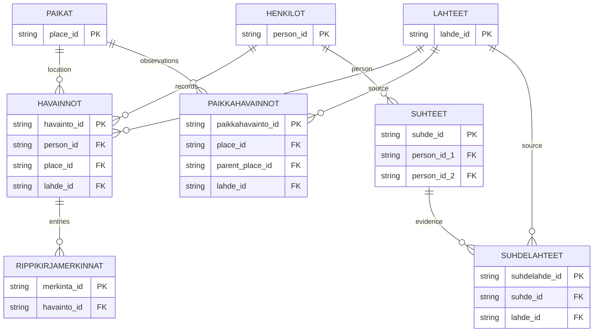

# Data Model

This document will describe the design decisions behind the genealogy database.

The model will address historical-data challenges such as changing names, patronymics, household structures, residence over time, place identifiers, relationships between people, source references and uncertainty in archival records.

The data model will be documented alongside the SQL schema as the project develops.

## Core design principle

The database separates historical persons and places from observations found in archival sources.

A person or place represents an entity identified during research, while an observation represents what a particular historical source says about that entity at a specific time.

This distinction is important because historical sources may contain incomplete, conflicting or changing information.

## Main tables

The current data model consists of the following main tables:

- **Henkilöt (Persons)** – identified persons and their normalized basic information
- **Paikat (Places)** – identified historical places
- **Paikkahavainnot (Place observations)** – source-specific information about places, including historical hierarchy and place type
- **Havainnot (Observations)** – source-specific information recorded about a person at a particular place or time
- **Suhteet (Relationships)** – identified relationships between persons, such as parent-child relationships and marriages
- **Suhdelähteet (Relationship sources)** – source references and evidence supporting identified relationships
- **Lähteet (Sources)** – archival sources used in the research
- **Rippikirjamerkinnät (Communion book entries)** – recurring and special entries connected to a person's observation in a communion book

  
## Entity relationship diagram

The current database structure can be represented with the following entity relationship diagram.

